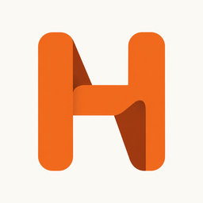
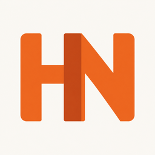

# This Week in HN logo proposals

Round 01 contains three independent proposals generated with the built-in image generation tool. They are proposals awaiting the editor's selection, not approved production identities.

| ID | Direction | Preview |
| --- | --- | --- |
| H1 | Orange folded H on warm ivory; closest to the folded-letter language of the AI sibling logo. |  |
| H2 | Compact HN monogram with a shared central upright. |  |
| H3 | Ivory folded N and gathered page edge on orange. |  |

Each direction has an unmodified native raster master, 1024px and 512px PNG exports, and a 256px preview. The background is opaque. These are raster proposals; no SVG or vector master is supplied.

Target colors are warm orange and ivory, with a burnt-orange fold accent. The exact prompt set and generation mode are in [generation.json](round-01/generation.json). Native generation may vary slightly from the requested hex colors. The proposal names do not imply user approval.
